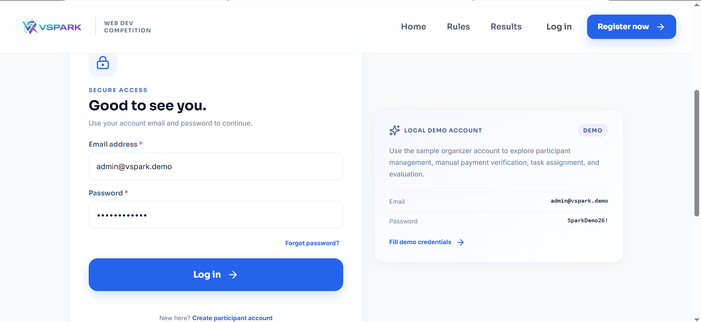
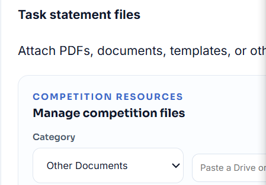
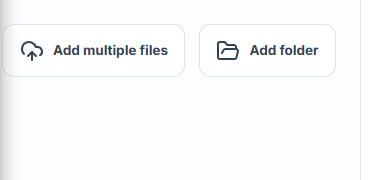

# VSpark Web Development Competition Portal

A web portal for publishing web-development competitions and managing participant registration, submissions, judging, resources, and results. This repository contains the React/Vite application, Supabase schema and migration, and a Supabase Edge Function for organizer integrations.

## Project links

- **Live deployment:** [VSpark Competition Portal](https://vspark-web-competition-git-main-zainab16.vercel.app/web-development-competition)
- **GitHub repository:** [zenbaayy/VSPARK-WEB-COMPETITION](https://github.com/zenbaayy/VSPARK-WEB-COMPETITION)
- **Local application route:** `/web-development-competition`

## Screenshots

These screenshots show example portal screens. The demo login details below are for the browser-only local demo mode; they are not the deployed Supabase administrator credentials.

### Login and local demo account



### Competition resource manager





## Technology stack

- **Frontend:** React 19, Vite 8, JavaScript, CSS, and Lucide icons.
- **Authentication and backend:** Supabase Auth, PostgreSQL, PostgREST, Row Level Security (RLS), Supabase Storage, database functions/triggers, and Supabase Edge Functions.
- **Google Drive selection:** Google Identity Services and Google Picker.
- **Organizer repository/deployment checks:** GitHub REST API and Vercel API, called by the authenticated `competition-integrations` Supabase Edge Function.
- **Hosting:** Vercel, with SPA route rewriting configured in `vercel.json`.

## Main modules

| Module | Purpose |
| --- | --- |
| Public competition pages | Competition catalog, details, rules, and published results. |
| Authentication and profiles | Participant sign-up, sign-in, password recovery, and profile access through Supabase Auth. |
| Competition registration | Registration tied to a competition; an account can join more than one competition, up to the configured limit of two. |
| Participant workspace | Competition-specific timer, task, draft, project links, resource uploads, and final submission. |
| Organizer competition manager | Create and edit competition information, rules/task content, duration, registration/payment settings, result visibility, and Drive folder links. |
| Resource manager | Add local files/folders or Drive selections, categorize resources, set visibility, and open/download permitted resources. |
| Organizer roster and judging | Review registrations and payment status, score entries against the 100-mark rubric, record winners, and export/print results. |
| Integration tools | Organizer-side GitHub repository checks and Vercel project status/redeploy actions through a Supabase Edge Function. |

## Database and storage

Supabase PostgreSQL stores profiles, competitions, registrations, submissions, resources, payment status, evaluation scores, and winner status. Auth user IDs connect authenticated users to their profiles and registrations. RLS policies restrict participant data and private files. Competition registration, timer, draft, and submission data are scoped to each registration so that separate competitions do not share state.

Key project files:

- `supabase/schema.sql` — complete setup for a **new** Supabase project, including tables, policies, storage configuration, functions, triggers, and starter competition data.
- `supabase/migrations/20261107_competition_scoped_workflow.sql` — additive workflow migration for an **existing** project with data. Back up the Supabase project and review the migration before running it. Do not use `schema.sql` as an upgrade on an existing production database.
- `supabase/functions/competition-integrations/index.ts` — authenticated server-side GitHub/Vercel integration endpoint.
- `COMPLETE_SYSTEM_WORKFLOW_AND_SETUP.md` — migration context and workflow verification checklist.
- `SETUP_GUIDE.md` — detailed Supabase, Google Picker, storage, integrations, and Vercel instructions.

The deployed frontend needs the matching database migration in the connected Supabase project. A successful frontend deployment alone does not apply that SQL migration. Confirm the migration completed without SQL errors and perform the documented smoke checks before treating the participant workflow as production-verified.

## External services and current limits

- **Supabase:** authentication, application database, private file storage, RLS, and Edge Functions.
- **Google Picker:** lets a consenting user select Drive files/folders and saves their IDs and metadata. It does not copy files into Supabase, recursively list folder contents, or upload files into the organizer's Drive.
- **GitHub REST API:** organizer repository checks. Public repositories may be checked without a token; private repository checks need an appropriately restricted read-only token stored as a Supabase Function secret.
- **Vercel API:** organizer status/redeploy actions for the Vercel project configured by the organizer. It does not access participants' personal Vercel accounts.
- **Not implemented:** automatic email or WhatsApp sending, payment processing, Google Sheets synchronization, automatic Drive uploads, and bulk announcement delivery. Contact links or saved participant API links do not mean the portal sends messages or calls those participant APIs.

Google OAuth may remain in Testing until the app owner completes Google Auth Platform configuration. In Testing, only configured test users can authorize; public availability may require publishing and any applicable Google verification. See `SETUP_GUIDE.md` for authorized origins, redirect URI, and Picker configuration.

## Local setup

Requirements: Node.js 22 or newer and npm.

```bash
npm install
Copy-Item .env.example .env.local
npm run dev
```

Open `http://localhost:5173/web-development-competition`.

Set the needed public configuration values in `.env.local` and restart Vite after editing them:

```dotenv
VITE_SUPABASE_URL=https://YOUR_PROJECT_REF.supabase.co
VITE_SUPABASE_ANON_KEY=YOUR_SUPABASE_PUBLISHABLE_OR_ANON_KEY
VITE_GOOGLE_CLIENT_ID=YOUR_WEB_OAUTH_CLIENT_ID.apps.googleusercontent.com
VITE_GOOGLE_API_KEY=YOUR_RESTRICTED_GOOGLE_API_KEY
VITE_GOOGLE_APP_ID=YOUR_GOOGLE_CLOUD_PROJECT_NUMBER
```

Google variables are optional unless Google Picker is being configured. `.env.local` is ignored by Git. Never put Supabase service-role keys, Google OAuth client secrets, GitHub/Vercel tokens, or mail credentials in frontend code or any `VITE_` variable.

### Local-only demo login

When Supabase is **not configured**, the app can run in browser-only demo mode with:

- Email: `admin123@gmail.com`
- Password: `ADMIN123`

This sample account is not a Supabase user and does not provide persistent/shared production data. When Supabase is configured, sign in with an account that exists in that Supabase project. Never publish real administrator credentials; rotate any real password that has been shared publicly or in a group chat.

## Vercel deployment

1. Import the GitHub repository into Vercel and select the Vite project root.
2. Add `VITE_SUPABASE_URL` and `VITE_SUPABASE_ANON_KEY` to the required Vercel environments. Add the three `VITE_GOOGLE_*` values only if enabling Google Picker.
3. In Supabase Auth URL Configuration, set the deployed site as a Site URL and allow the required callback URLs for the deployed app and local development.
4. If Google Picker is enabled, register the deployed web origin and exact callback/redirect URI in Google Auth Platform. Restrict the Google API key to the intended website origins and Picker API.
5. Deploy the commit containing the frontend and matching Supabase SQL setup. For an existing database, back it up and apply the migration described above before verifying participant flows.
6. After changing Vercel environment variables, trigger a new deployment. Test sign-up/sign-in, registration, resource access, submissions, and organizer permissions with test accounts.

Vercel uses `vercel.json` to route SPA paths to `index.html`, including `/web-development-competition` and its nested routes.

## Run and build commands

```bash
npm run dev
npm run build
npm run preview
```

## Security and project status

- Keep `.env.local`, provider tokens, and real login credentials out of GitHub.
- Browser `VITE_` variables are public. RLS and server-side secret storage provide the security boundary.
- Use the local demo account only in unconfigured local demo mode.
- Database migration, live provider credentials, and end-to-end production checks must be verified in the owner's Supabase, Google, GitHub, and Vercel accounts; this README does not claim those external account steps have passed.
